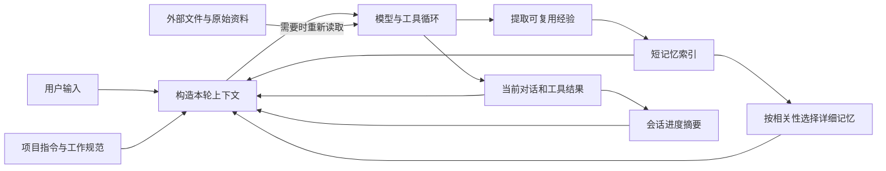

# Claude Code 的记忆与上下文：对交互型记忆的启发

调研日期：2026-10-13。延续 [交互型记忆项目与论文调研](interactive-memory-2026-10-13.md)，关注 DSH 回复高亮如何帮助用户参与后续上下文的构造，以及桌宠如何展示这个过程。

若要先理解 Claude Code 系统本身，阅读 [记忆系统源码走读](claude-code-memory-system-walkthrough-2026-10-13.md)：补充写入调用链、召回进入请求的时机、可关闭常驻索引的模式，以及 `autoDream` 的整理路径。

## 判断

Claude Code 值得参考的地方是：**把长期指导、任务续接、原始资料和当前上下文分开管理，再决定什么时候载入、更新或移出。** 单纯把所有摘录追加到提示词里，无法得到这样的能力。

你的高亮插件已有一个合适的入口：人在阅读回答时，知道哪句话值得留、哪里有问题、什么约束下次还有效。接下来最值得做的小工作，是将这种判断变成有来源、有作用范围、可检查的上下文。先验证“划线 → 写自己的判断 → 下一轮选择带入 → 回到原文”的闭环。

以下是设计参考和建议，不是本仓库已实现的记忆功能，也不构成新颖性或性能结论。

## 材料和可信度

| 层级 | 本轮实际核查 | 可以得出的结论 |
|---|---|---|
| 官方当前材料 | `anthropics/claude-code` 发行记录及公开 `mods/agents-md` 扩展源码；官方 Skills、Python Agent SDK、cookbook 和 autonomous-coding 示例 | 确认公开能力和工程原则；示例程序不等于 Claude Code 内部实现 |
| 官方发行元数据 | npm `@anthropic-ai/claude-code` 最新版本为 **2.1.296**，同时存在平台原生包依赖 | 只说明检查时 npm 的版本，不证明所有平台、账户和灰度开关相同 |
| 第三方历史快照 | [Exhen/claude-code-2.1.88][snapshot]，静态读取 source 和 `cli.js.map`；抽查 5 个记忆/上下文文件与 map 内 `sourcesContent` 完全一致 | 证明仓库内部抽取一致；**不能独立证明其来自未修改的官方发行物** |
| 第三方解析 | [How Claude Code Works][analysis] 的上下文与记忆章节，逐项回看快照和官方记录 | 用于导航和提出问题，不把解析作者的推论直接当成产品事实 |

官方公开仓库不是完整核心源码。历史快照的原 npm `2.1.88` 在本轮查询中返回版本不存在，无法重新获取官方 tarball 来认证来源；没有运行该快照。当前研究只保存概括、证据路径与链接，没有把它的源码迁入 AI-pets。

Anthropic 工程博客和 Claude 文档站直连被本环境网络策略拒绝。下文涉及博客的原则，以可读取的**官方配套 cookbook、Skills 和 quickstart**交叉核对；并未逐篇读取博客网页全文。提交、文件路径和校验信息见 [来源清单](claude-code-memory-context-sources.json)。

## 先按职责理解构造

这是便于理解的职责图，不是声称当前每个版本都按这个顺序执行的调用图：

其中有四种不同的材料：

- **指令**：项目约定、做事方法和必须遵守的限制。`CLAUDE.md` / Skills 是重要的公开入口；它们也要控制大小和加载范围。
- **长期记忆**：跨会话仍有价值的用户信息、反馈、项目背景和资料指针。
- **会话摘要**：目前做到哪里、还有什么请求没完成、什么尝试失败过，服务于当前工作的续接。
- **原始资料**：完整消息、文件、搜索结果等，可保存在上下文之外，需要时读取。

例如，“今天先推送备份”属于当前任务；“我更喜欢能独立完成小功能的插件”可能是持续偏好；某段源码应保存位置和版本，后续读最新文件。这些材料需要不同的更新和使用规则。

## 六个最值得借鉴的机制

### 1. 短索引常驻，详情按需读取

历史快照 `src/memdir/memdir.ts` 将 `MEMORY.md` 作为简短入口，详细记忆另存文件。官方 **2.1.83** 发行记录确认索引有 200 行及名义上的 25KB 限制；**2.1.210** 又明确让超限写入报错，避免静默截断。这说明预算和超限反馈是产品能力的一部分。

对 DSH 的建议：收藏侧栏可以保存很多片段，发给模型的集合应保持少量且相关。建立片段摘要/索引，详情保留原文引用。首版直接从当前项目的少量候选中选取，不需要先引入向量数据库。

不要照搬“200 行”作为中文产品的 token 预算。快照中名为 bytes 的统计实际使用 JavaScript 字符串长度，也不是精确 UTF-8 字节数；自己的实现应明确计量方式，并记录真实输入 token。

这里描述的是索引模式。快照也存在开关可关闭常驻索引、改用相关记忆附件；主动预取结果在工具循环间隙带入，不保证进入首个模型请求。因此不能把“所有记忆总是在发问前加载”当作统一行为。

### 2. 反馈记忆保存规则、原因和适用条件

快照 `src/memdir/memoryTypes.ts` 区分 `user / feedback / project / reference`。其中 feedback 包括用户纠正，也包括用户认可的非显然做法；保存结构强调规则、Why、How to apply。项目背景容易变化，日期应具体，旧记忆需要与当前资料核对。

对高亮的启发：把用户的判断和原文分开保存。例如原回复建议“把状态识别和动画映射分开”，用户批注“认可，WavePet 接 DSH 时继续这样做”。未来可用的记忆是这条有项目范围的判断，而不是系统凭划线推断用户认可整段回答。

读过、赞同、怀疑、反对、要求以后遵守，是不同的意图。划线默认是一条阅读记录；用户可以进一步选择将其用作项目指导或待验证问题。认可观点也不等于已经核实事实。

### 3. 召回也有选择、去重、预算和取消

快照 `src/memdir/memoryScan.ts` 读取记忆文件头部描述；`findRelevantMemories.ts` 将查询、描述清单和最近工具活动交给一个模型选择，结构化返回至多 5 个文件名。实现会在选择前排除已载入项，验证文件名，不确定时允许返回空集合。

这条路径使用 `getDefaultSonnetModel()`，不能从中推出“召回必定用最便宜模型”。`utils/attachments.ts` 的主动预取受服务端功能开关控制，并检查会话累计预算；用户取消时会取消辅助查询。它是历史快照里可见的能力，不代表所有现行用户默认启用。

你的插件已有独立辅助调用、结构校验和少量输出，适合延续这个模式：先按项目/状态筛候选，再尝试 Flash 选择必要片段，比较其准确率和成本。用户指定必须带入的少量项目约束应单独处理，避免被相关性排序偶然漏掉。

### 4. 压缩对话、清理工具结果、持久记忆各有用途

官方 [Context Engineering Tools cookbook][context-cookbook] 明确区分：

| 操作 | 解决的问题 | 对本工作的参考 |
|---|---|---|
| Compaction | 长对话占满上下文，以摘要续接；摘要有损 | 保留用户目标、未完成事项、已确认约束和关键判断 |
| Tool-result clearing | 可再次获取的旧工具结果过大，保留调用记录、移出负载 | 原资料留在外部，不让每轮输入携带所有全文 |
| Memory | 知识和经验要跨任务/会话持续存在 | 将用户确认的指导、背景与资料指针保存到独立存储 |

快照的 `services/SessionMemory/prompts.ts` 为会话笔记设置 Current State、Task specification、Errors & Corrections、Key results 等栏目；`services/compact/sessionMemoryCompact.ts` 展示如何用笔记和未总结的近期消息续接。但后台会话笔记与这种压缩路径也分别受开关控制。

对你来说，用户标明的项目约束、待验证点和反对意见，是摘要时值得保留的显式信号。完整摘录仍保存于原文档案中；摘要不应悄悄改写原引用。可以先做手动生成“继续这项工作”的简短卡片，无需一开始就做持续后台总结。

### 5. 缓存复用依赖请求构造，并且要可测量

官方 [Session Memory Compaction cookbook][session-cookbook] 展示在已有对话前缀后追加总结任务，复用缓存来降低辅助总结成本。其成本例子属于特定演示，不能作为 DSH 的既定收益。

当前官方发行记录更具体：**2.1.251** 增加 `/cost` 的会话缓存命中率、miss、重缓存 token 等统计；**2.1.260** 增加可能的 miss 原因，例如工具定义/系统提示变化和 TTL 到期。多条修复涉及恢复会话、模型切换、工具定义重排造成的缓存变化。

快照中的 `utils/api.ts`、`services/api/claude.ts` 和 `extractMemories.ts` 也体现稳定前缀、fork 参数复用和 usage 记录。后台长期记忆提取本身受开关控制，不能概括为“每次回复一定提取”。涉及内部缓存扩展的实现，也不能直接当成 DSH 或公开 API 保证。

**核对你的现有代码**：`dsh-answer-highlighter/src/model.js` 使用自定义 system，并把 question + answer 重新组装为一个 user message。传入同一 `sessionId` 本身不保证与主请求前缀一致；当前收集输出文本的路径也没有保存模型 usage。已验证的是本地 JSONL 标注结果复用，不是主对话的 KV 缓存命中。

后续比较两个方案：短问答辅助调用，以及在 host 支持时共享主对话前缀的追加任务。记录 provider、model、输入/输出、缓存读写或提供商对应字段、延迟和总费用；如果 usage 不可得，显示未知。长前缀即使命中，也未必比一个很短的 Flash 请求更便宜。

### 6. 大型指令和工作方法渐进加载

官方 [Skills][skills] 采用元数据、触发后的 SKILL.md、按需读取资源的层次。当前公开的 [agents-md 扩展][agents-md] 则展示项目指令的目录层级、读取子目录文件时追加局部规则、按路径/内容去重，以及 fork 对已交付规则的继承。

对 DSH 的启发：项目卡片只放少量持续约束，领域指南和较长资料在任务触发时载入。进一步可以把经过多次验证的用户做法整理为一个可编辑的小工作流程，但单条高亮无需马上升级成 Skill。公开扩展的实现也不证明 DSH 已有相同 hook 或继承语义。

## 怎样延伸为你自己的工作

### 首版：能检查的下一轮上下文

建议在现有高亮插件上增加一条短链路：

1. 选择原回复片段，保存引用和消息身份。
2. 留下自己的判断，选择“阅读笔记 / 项目指导 / 待验证”，普通高亮保持低负担。
3. 发问前显示“本轮将带入”的少量卡片，可移除、编辑、查看范围或跳回原文。
4. 请求发出后，记录实际发送的记忆 ID/版本，支持检查和停止后续使用。

界面宜写“已带入本轮请求”；如果回答有引用，可另行展示引用。发送过某条记忆不能证明它在模型内部实际改变了回答，不宜把这两件事混为一个“使用成功”状态。

先修一个现有基础问题：`src/storage.js:list()` 返回扁平 annotations，丢掉外层 record 的 `messageId`。手动批注和原文跳转应贯穿保留 session/message 身份，并使用 exact quote + 邻近文本定位；重复文本或未挂载消息不能只靠全文字符串搜索。

一种可逐步实现的数据分工是：

| 对象 | 首版应保留的信息 |
|---|---|
| 原文批注 | annotation ID、session/message ID、exact/prefix/suffix、原回答版本或校验值、用户备注与意图、创建时间 |
| 可复用记忆 | memory ID、关联的批注 ID、用户确认的指导、项目范围、启用/失效状态；有需要时增加原因、适用条件、复核时间 |
| 本轮记录 | 请求/轮次 ID、实际带入的 memory ID 和版本、选择理由、可取得的 token/缓存/延迟统计 |

保留三个对象的关联，而不是让模型改写唯一的一份原始摘录。存储可以延续现有本地方式；先把闭环做完整再决定是否需要数据库。

### 后续的小扩展

- **会话交接卡**：从已确认批注、当前任务和未完成项生成可编辑的续接材料；换会话或换 harness 时由用户带走。借鉴官方 [长期编码 quickstart][quickstart] 的 `claude-progress.txt`、`feature_list.json` 和 Git 记录，但无需照搬其 200 个测试用例演示规模。
- **旧记忆复核**：截止日期经过、来源消息被编辑、项目目标改变时，把记忆标成待复核；保留更正链和原文。优先做能解释原因的触发规则。
- **桌宠作为入口**：用真实事件显示“正在整理”“有待复核记忆”“生成交接卡”，点击打开对应卡片。既有 hooks 可以观察部分工具/压缩生命周期；是否写入或载入某条记忆，应由自己的记忆服务发事件。不要从沉默时间或表情推断模型已经记住。

在 Claude Agent SDK 上，可用公开 `UserPromptSubmit` 的 `additionalContext` 做受控载入原型；`PreCompact` 可用于观测压缩前事件。这些并不开放内部记忆选择器的全部控制。DSH 应另行核对具体 host 版本的请求构造入口，接入自己的记忆服务；当前 AI-pets 的 DSH 桥仍未实现。

## 怎样判断是否值得继续

使用同一组跨会话项目任务比较：原插件、手动收藏、带意图与范围的上下文卡片。首轮重点观察：

- 后续回答是否遵守用户确认的约束，是否把怀疑或反对错误当成赞同。
- 载入片段是否相关，旧记忆/其他项目的记忆是否被错误带入。
- 用户能否返回正确原文、修正记忆并在下一轮看到修正生效。
- 操作时间、辅助调用总成本和延迟，是否足以换来更少的重复解释。

这是可验证的产品和研究问题：**在阅读时表达意图、在使用前看见上下文，能否让用户以更小负担得到更准确的跨会话指导？** 前一篇调研已有 Memory Sandbox 等直接前作；需要与它们比较，而不是将“可编辑记忆”本身当作首次提出。

## 推荐阅读顺序

1. [Effective context engineering for AI agents][context-blog]，配合已核查的 [官方三种上下文机制 notebook][context-cookbook]：理解有限上下文和不同处理策略。
2. [Session Memory Compaction][session-cookbook]：直接看会话摘要、后台更新和前缀缓存的配套实现。
3. [Equipping agents for the real world with Agent Skills][skills-blog]，配合 [Skills 仓库][skills]：理解按需加载工作方法。
4. [Effective harnesses for long-running agents][harness-blog]，配合 [autonomous-coding 示例][quickstart]：理解跨会话续接需要哪些外部材料。
5. [源码解析的记忆章节][analysis-memory] 和 [上下文章节][analysis-context]，再回看历史快照的 `memdir`、`SessionMemory`、`extractMemories`、`compact`：重点检查开关、调用者和失败回退。

阅读解析时注意：源码里存在一个模块，不等于默认启用；一个示例节省的成本，不等于任意产品的收益；历史实现，不等于当前发行版。官方当前记录对索引预算、记忆编辑界面和缓存可观测性的确认，比猜测隐藏功能更适合指导近期产品工作。

[snapshot]: https://github.com/Exhen/claude-code-2.1.88/tree/c8cd253554319f32ff64ff7000636199f720c9bc
[analysis]: https://github.com/Windy3f3f3f3f/how-claude-code-works/tree/f4d6505ed9162a0ee6be089190f74c419ecacb19
[analysis-memory]: https://github.com/Windy3f3f3f3f/how-claude-code-works/blob/f4d6505ed9162a0ee6be089190f74c419ecacb19/docs/08-memory-system.md
[analysis-context]: https://github.com/Windy3f3f3f3f/how-claude-code-works/blob/f4d6505ed9162a0ee6be089190f74c419ecacb19/docs/03-context-engineering.md
[context-blog]: https://www.anthropic.com/engineering/effective-context-engineering-for-ai-agents
[skills-blog]: https://www.anthropic.com/engineering/equipping-agents-for-the-real-world-with-agent-skills
[harness-blog]: https://www.anthropic.com/engineering/effective-harnesses-for-long-running-agents
[context-cookbook]: https://github.com/anthropics/anthropic-cookbook/blob/9c1e493ddd2b82df399d2a61b9c806c539e18be6/tool_use/context_engineering/context_engineering_tools.ipynb
[session-cookbook]: https://github.com/anthropics/anthropic-cookbook/blob/9c1e493ddd2b82df399d2a61b9c806c539e18be6/misc/session_memory_compaction.ipynb
[skills]: https://github.com/anthropics/skills/tree/dbd4588f9e1033efb41dad4bef2f7947c8993d44
[agents-md]: https://github.com/anthropics/claude-code/tree/bf2323b3021c9d3db7a31e1e7d61068c3f704497/mods/agents-md
[quickstart]: https://github.com/anthropics/claude-quickstarts/tree/9ec32b91df50b0d4906cae64b13c6298055ff40d/autonomous-coding
