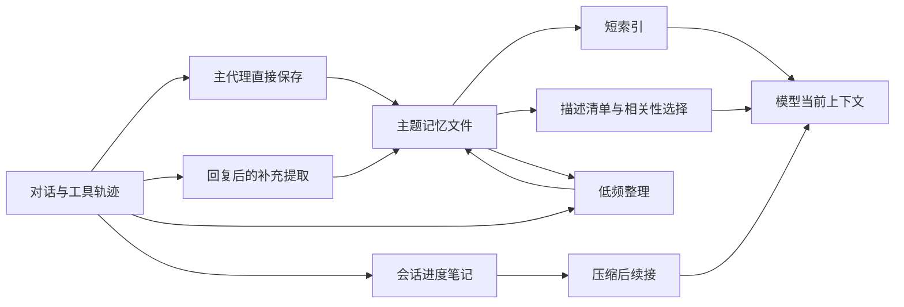

# 直接看 Claude Code 的记忆系统

日期：2026-10-13。这篇沿源码解释记忆系统本身，补充上一篇 [Claude Code 记忆与上下文调研](claude-code-memory-context-2026-10-13.md)。重点是存储、写入、召回、整理和会话续接。

核心认识：**模型负责判断与整理内容，harness 负责安排读写的时机、工具范围、上下文预算和恢复过程。** 下面追踪的长期记忆路径以 Markdown 文件为载体，通过模型的文件工具和辅助模型查询运作。

## 证据范围

具体函数来自第三方 `2.1.88` 历史快照，不是当前完整官方源码。官方仓库和 npm 在本次会话核查时的版本为 `2.1.296`。历史快照无法从原官方 tarball 独立认证，功能开关也不能证明当前默认状态。提交、文件校验和本轮追加检查见 [来源清单](claude-code-memory-context-sources.json)。

官方发行记录可以确认自动记忆、索引预算、记忆编辑界面等公开能力；当前 **2.1.288** 的修复记录也确认记忆召回会遇到不支持结构化输出的网关问题。`autoDream` 的具体实现以下只作为快照中可见的设计分析。

## 1. “记忆”覆盖几种不同材料

| 材料 | 用途 | 谁主要维护 |
|---|---|---|
| `CLAUDE.md`、`.claude/rules/` | 项目规则和工作指导，按范围加载 | 用户、团队，也可要求代理修改 |
| Auto memory | 跨会话仍有用的用户信息、反馈、项目背景和资料指针 | 主代理；满足开关条件时也有后台提取 |
| Session memory | 当前任务状态、未完成请求、错误、更正与关键结果 | 专门的会话摘要路径 |
| 会话 JSONL | 原始对话和工具轨迹，需要时搜索 | harness 记录 |

独立子代理还可配置 `memory: user / project / local`。`tools/AgentTool/agentMemory.ts` 为它们选择不同的持久目录，避免把所有角色的经验混在一个文件里；官方 **2.1.33** 发行记录确认了该配置入口。

## 2. 长期记忆怎样存放

`memdir/paths.ts#getAutoMemPath()` 的默认路径形如：

```text
~/.claude/projects/<规范化后的 Git 根目录标识>/memory/
├── MEMORY.md                 # 入口索引
├── user_background.md        # 一份主题记忆
├── feedback_workflow.md
└── project_direction.md
```

目录标识由路径规范化生成，不应假定它是向量库 ID 或哈希。实现会寻找同一仓库的 canonical Git root，使不同 worktree 共享默认记忆目录；也支持受信设置指定其他位置。

主题文件使用 `name / description / type` 的 frontmatter。`description` 很重要：后续选择器主要靠它判断这份文件与问题是否相关。正文记录具体内容，feedback/project 类型的提示词要求保留原因和适用方式。

系统引导四种类型：`user`、`feedback`、`project`、`reference`。但扫描器会兼容缺少或未知类型的旧文件，分类主要通过提示词指导内容组织，并非每个字段都由强制数据库 schema 拦截。

默认索引模式要求模型完成两次文件操作：写主题文件，再更新 `MEMORY.md` 链接。这不是这里可见的一个事务性数据库写入，也不能把“写了主题文件”与“所有后续入口已经更新”视为同一件事。

## 3. 谁决定保存什么

### 主代理直接写入

`memdir/memdir.ts#buildMemoryLines()` 把保存准则加入提示词。主代理可以在工作中调用常规 `Read / Write / Edit` 文件工具，保存长期有用的反馈或背景。这里分析的是 Claude Code 的文件记忆路径；官方 API 的 `memory` tool 是另一种可供开发者实现的接口。

准则强调保存代码本身不能充分说明的背景，例如用户为什么采用某种做法；对能从当前源码和 Git 历史重新获取的内容，优先读取当前资料。反馈同时包含用户纠正和用户确认的有效做法。

### 回复结束后的补充提取

调用链为：

```text
query/stopHooks.ts
  → executeExtractMemories()
  → runExtraction()
  → runForkedAgent()
  → 在记忆目录内 Write / Edit
```

这条路径需要构建和服务端开关，也受 auto-memory 设置等条件约束。它复用主对话前缀，给 fork 追加一个提取任务，让模型检查近期新增消息及已有记忆清单。

调度代码有消息游标：成功提取后推进，失败时保留，便于下次重试。如果主代理已经在这段消息中写过记忆，后台提取会跳过该范围。正在提取时又来了新请求，会合并为一次尾随提取，处理最新上下文。

后台提取只允许只读工具及记忆目录内的写入，最多运行 5 个模型轮次。它被要求提取已经出现的信号，不再展开源码调查。**写入是提炼阶段；准备依据旧记忆给出具体建议时，提示词再要求核对当前文件或配置。** 这解释了存储速度与信息复核为何分开处理。

## 4. 下一次对话怎样读到它

### 常驻索引与代理自主读取

默认索引路径为：

```text
context.ts#getUserContext()
  → utils/claudemd.ts#getMemoryFiles()
  → 读取 MEMORY.md，构造上下文
  → 主代理根据索引决定是否 Read 主题文件
```

入口有大小上限。正文保存在外部文件，只有需要时才读取。主代理并非只能依赖一个自动检索器，也可以主动查找和阅读记忆。

### 模型选择相关文件

快照里另有主动召回：

```text
query.ts#queryLoop()
  → startRelevantMemoryPrefetch()
  → scanMemoryFiles()                 # 描述、类型、修改时间
  → findRelevantMemories()            # Sonnet 返回相关文件名
  → readMemoriesForSurfacing()
  → 工具循环间隙加入附件
  → 后续模型请求
```

扫描阶段读取主题文件头部，排除 `MEMORY.md`，按修改时间排序，最多提供 200 个候选。选择阶段输入用户问题、候选描述和最近工具活动，最多选择 5 个文件，允许不选。输出文件名必须属于候选集合。

实现会排除已提供的记忆，并限制单文件约 4KiB、当前上下文中主动召回累计约 60KiB。累计计数来自消息中的附件；压缩移除旧附件后，可以重新召回。长文件仍可由主代理主动完整读取。

**召回结果并不保证进入首个模型请求。** `queryLoop()` 每个用户轮次启动一次预取，不等待结果；只有完成后才在工具循环中收取。单次文字输出结束的正常路径可能在这个收取点之前返回。这是这份快照中“尽量隐藏召回等待”的具体取舍，不能描述成“用户发问前所有记忆已经准备好”。

另外，`utils/claudemd.ts#filterInjectedMemoryFiles()` 有开关可移除常驻记忆索引，改用附件召回。因而“MEMORY.md 永远都会送入模型”并不是该快照所有配置下都成立的结论。

## 5. 记忆如何持续整理：autoDream

除了写入和召回，快照存在后台 consolidation 路径：

```text
回复结束
  → executeAutoDream()
  → 检查启用设置、时间、积累的会话与锁文件
  → fork 执行 buildConsolidationPrompt()
  → 整理主题文件及索引
```

代码内的调度默认值是至少间隔 24 小时、积累至少 5 个其他会话；服务端配置可覆盖它们。它还排除当前会话、节流重复扫描，并用 PID/mtime 文件尽力协调并发。不是一个每晚固定时间必定运行的计时器，也不能据此声称所有现行用户都在后台“做梦”。

整理提示词分四步：查看已有记忆；寻找新信号并按需搜索会话记录；合并或修正主题内容；整理索引、移除过时指针。它要求窄范围搜索大 JSONL，而不是重读全部历史。

一个细节是：后台写入权限允许 Edit/Write，禁止 Bash `rm`。提示词所说的移除过时事实，可以通过修改正文和索引完成；不能从提示词推断后台一定物理删除文件。而主动召回扫描全部 `.md`，因此**删除索引链接和使主题文件不再被召回，是两种不同的操作**。

## 6. Session memory 怎样帮助压缩后续接

长期偏好以外，快照将会话笔记保存到：

```text
<projectDir>/<sessionId>/session-memory/summary.md
```

`services/SessionMemory/prompts.ts` 的结构包含当前状态、任务规格、相关文件、工作方式、错误与更正、关键结果和简短工作日志。

它按上下文增长和工具活动决定是否更新，不是每条消息都总结。快照的默认配置为：上下文到约 10K token 后初始化，后续增长约 5K token，结合工具调用数或自然结束点触发；这些值可以被配置覆盖。

启用会话笔记压缩时，`compact/sessionMemoryCompact.ts` 将笔记与未总结或需要保留的近期消息组合，还会修正工具调用/结果配对，避免截断出不合法的请求。笔记缺失、为空或边界不可确定时，会回退到通常的压缩路径。

主线程压缩后的 `postCompactCleanup.ts` 会清理上下文和记忆文件的缓存，让下一轮重新构造指令/索引；子代理压缩则避免破坏主线程共享状态。文件记忆持续存在，当前上下文会重新组织。

## 7. 把系统连起来看



图中后台路径均应结合对应开关理解。值得继续研究的三个核心问题是：提取时怎样判断“值得长期保存”，召回时怎样平衡相关性与等待，整理时怎样更正旧内容并保留可信来源。

## 源码阅读入口

- [目录和启用逻辑](https://github.com/Exhen/claude-code-2.1.88/blob/c8cd253554319f32ff64ff7000636199f720c9bc/source/src/memdir/paths.ts)
- [保存准则与类型](https://github.com/Exhen/claude-code-2.1.88/blob/c8cd253554319f32ff64ff7000636199f720c9bc/source/src/memdir/memoryTypes.ts)
- [后台提取](https://github.com/Exhen/claude-code-2.1.88/blob/c8cd253554319f32ff64ff7000636199f720c9bc/source/src/services/extractMemories/extractMemories.ts)
- [相关性选择](https://github.com/Exhen/claude-code-2.1.88/blob/c8cd253554319f32ff64ff7000636199f720c9bc/source/src/memdir/findRelevantMemories.ts)
- [整理调度](https://github.com/Exhen/claude-code-2.1.88/blob/c8cd253554319f32ff64ff7000636199f720c9bc/source/src/services/autoDream/autoDream.ts)与[整理任务说明](https://github.com/Exhen/claude-code-2.1.88/blob/c8cd253554319f32ff64ff7000636199f720c9bc/source/src/services/autoDream/consolidationPrompt.ts)
- [会话记忆压缩](https://github.com/Exhen/claude-code-2.1.88/blob/c8cd253554319f32ff64ff7000636199f720c9bc/source/src/services/compact/sessionMemoryCompact.ts)
- [官方当前发行记录](https://github.com/anthropics/claude-code/blob/bf2323b3021c9d3db7a31e1e7d61068c3f704497/CHANGELOG.md)

本轮是静态调用链分析，没有运行该快照，也没有测量真实账户上各功能的启用率或效果。
